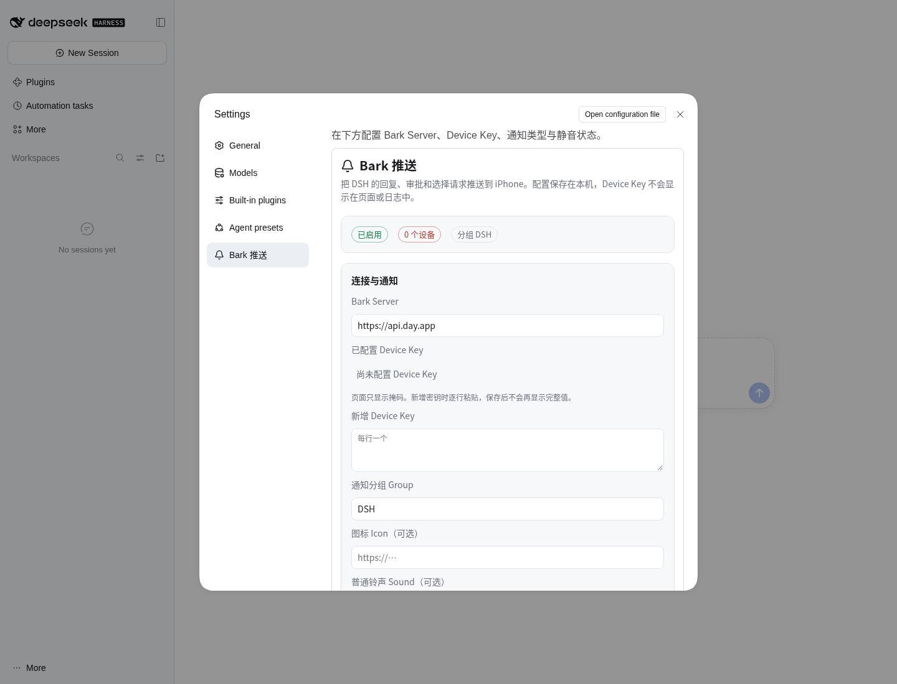

# dsh-bark-push

把 **DeepSeek Harness（DSH）** 的回复、审批请求和用户选择请求推送到 iPhone 的 Bark 插件。

- 不修改 DSH 核心代码，只使用 DSH 的事件、服务、HTTP 路由和客户端 Slot。
- 支持工作区级、对话级两层静音，状态持久化。
- 通知发送完全异步：Bark 故障不会阻塞对话、工具调用或审批流程。
- 配置页、测试推送、静音管理都在 DSH 的 **Settings → Bark 推送** 中完成。



---

## 1. 已实现 / 已验证 / 受 DSH API 限制

| 能力 | 状态 | 说明 |
|---|---|---|
| Agent 正式回复推送 | ✅ 已实现、已测试 | 监听 `session/event` 的 `assistant/message` + `turn/end`，只在 `completed` 回合推送最后一条可见文本 |
| 流式输出不重复推送 | ✅ 已实现、已测试 | 不监听 delta；每回合最多一条，按 `sessionId + turn` 去重 |
| 需要批准推送 | ✅ 已实现、已测试 | 监听 `approval/asked` 审计事件，标题固定 `需要批准`，使用重要级别 |
| 等待选择推送 | ✅ 已实现、已测试 | 观察 `user-questions/request` waterfall，通知后调用 `next()`，不影响真正的回答 UI |
| 工作区静音 | ✅ 已实现、已测试 | 工作区右键菜单 / 设置页；按 `WorkspaceId` 持久化 |
| 对话静音 | ✅ 已实现、已测试 | 会话右键菜单 / 行内铃铛 / 设置页；按 `SessionId` 持久化 |
| 静音优先级 | ✅ 已实现、已测试 | 工作区静音优先；任一层级静音即禁止推送；发送前重新检查 |
| 重启后静音仍有效 | ✅ 已实现、已测试 | `$DSH_HOME/bark-push/state.json`，模式 0600，原子写入 |
| Bark 配置界面 | ✅ 已实现、已验证 | Settings 内嵌管理页，支持 Server、Device Key、Group、Icon、Sound、级别、长度、超时、重试、类型开关 |
| 测试推送 | ✅ 已实现、已验证 | 设置页按钮；使用本地 Bark 兼容 mock 验证了完整请求载荷 |
| 点击通知跳转 | ⚠️ 部分实现 | 通过客户端桥接 `?barkSession=<id>` 打开会话；DSH 本身没有可寻址的会话 URL |
| 通知内直接批准/选择 | ❌ 不实现 | 按需求交互仍由 DSH 负责；Bark 只负责提醒 |
| 真实 iPhone 送达 | ⚠️ 未验证 | 没有使用用户的真实 Device Key；需要用户在设置页填写自己的 Bark Key 后点“测试推送” |

---

## 2. 实现前的代码库分析

### 2.1 DSH 插件形态

当前环境是 `@deepseek-ai/dsh@0.2.2-rc.1`。DSH 的插件系统基于 Cordis：

- 插件是一个 ESM 包，导出 `name`、可选的 `inject`、可选的 `Config` 和 `apply(ctx, config)`。
- 插件通过 profile 的 Loader 条目加载；`dsh plugin --profile <name> add <pkg>` 会把包加入 profile 依赖和 `dsh.profile.bundles`。
- profile 的 `cordis.patch.yml` 是用户覆盖层；bundle 自己的 `dsh.bundle.patch` 会在 bundles 顺序中插入条目。
- 浏览器半边由 `package.json` 的 `dsh.client` 声明，构建产物从 `./client` 导出，由 `dsh-client-modules` 通过 `/plugins/...` 提供。
- 插件不需要导入 `@deepseek-ai/cordis`。外置插件安装在 profile 的 `node_modules` 下，直接依赖 DSH 安装目录内的包并不可靠；本插件因此只用 Node 内置模块和 `ctx` 注入的服务。

### 2.2 实际使用的事件、服务与 API

| 需求 | 使用的 DSH 机制 | 位置/说明 |
|---|---|---|
| Agent 回复完成 | `ctx.on('session/event', ...)` 的 `assistant/message`、`turn/end` | `turn/end.data.reason.kind === 'completed'` 才推送；取该回合最后一条 `message.content` 中的 `text` 块 |
| 会话销毁清理 | `session/disposed` | 清理回合缓存、标题缓存 |
| 审批请求 | `session/event` 的 `approval/asked` | 事件带 `id`、`toolName`、`reason`、`callId`；按 `id` 去重 |
| 用户选择 | `ctx.on('user-questions/request', (request, next) => ...)` waterfall | 只观察并 `next()`，不 claim；`request.wait.callId` 可作为去重键 |
| Workspace 身份 | `ctx.workspaceRegistry.list()/get()/resolveByPath()` | 稳定 `WorkspaceId`；成员关系优先，cwd realpath 兜底 |
| Conversation 身份 | `session.header.id` / `session.id` | `SessionId`，作为会话静音键 |
| 会话标题 | `ctx.sessionTitle.get(session)`，以及 `session/title` 事件缓存 | 回复标题、审批/选择正文上下文 |
| 配置 | Loader `config`（`cordis.patch.yml` / bundle patch） | 所有字段有 JS 默认值；不依赖 schemastery |
| 可变状态 | `$DSH_HOME/bark-push/state.json` | DSH 没有“插件自定义可变状态”的通用服务；JSON 文件是兼容性最好的做法 |
| 配置/静音 HTTP API | `ctx.connection.fetch.register(...)` | `/api/bark-push/*`，自动复用浏览器 Cookie 认证、Host/Origin 检查和 owner Peer 限制 |
| 公共跳转地址 | `ctx.webApp.getAdvertisedUrl()`，回退 `ctx.webServer.getOrigin()` | 兼容反向代理下的 `publicUrl` |
| 客户端设置页 | 客户端 `settings.section` Slot | 内嵌 `/api/bark-push/ui?embed=1` |
| 工作区/会话右键菜单 | 客户端 `ctx.contextMenus.register({ target: 'workspace'|'session' })` | 原生右键菜单项 |
| 会话行铃铛 | `sidebar.workspaces.session.row.action` Slot | 有会话行时显示 🔔/🔕 |
| 会话跳转 | 客户端 `ctx.uiWorkspace.openSession(sessionId)` | 读取 `?barkSession=` 后调用 |

### 2.3 没有凭空假设的 API

实现时刻意没有使用以下不存在或不可靠的接口：

- 没有 `ctx.notifications`、`ctx.conversation.mute` 之类的官方静音 API；静音状态由插件自己持久化。
- 没有“会话 URL 路由”或 `?session=` 的官方约定；DSH Web 客户端通过内存状态选择会话，因此插件增加了一个只处理 `barkSession` 查询参数的客户端桥接。
- 没有审批专属页面 URL；审批卡片在会话对话流中，所以点击审批通知只会打开对应会话。
- 没有直接订阅 assistant delta 的公开事件；`session/event` 只在提交时触发，因此天然避免流式重复。
- 没有修改 DSH 核心代码，也没有依赖私有存储格式。

---

## 3. 安装与启用

### 推荐方式：插件管理器

```bash
cd /path/to/dsh-bark-push
./scripts/install.sh web
```

脚本等价于：

```bash
dsh plugin --profile web add link:/path/to/dsh-bark-push
```

`dsh plugin add` 会把包加入 profile 依赖，并把 `dsh-bark-push` 追加到 `dsh.profile.bundles`。包的 `cordis.patch.yml` 会插入 `bark-push` Loader 条目：

```yaml
- insert:
    - id: bark-push
      name: dsh-bark-push
      config:
        server: https://api.day.app
        deviceKeys: []
        group: DSH
        enabled: true
        # ...
```

重启 profile（或等待 `dsh-hmr` 重载）：

```bash
dsh --profile web
```

然后打开 **Settings → Bark 推送**。

### 手动安装

1. 把本目录放到 profile 可访问的位置。
2. 在 profile 的 `package.json` 中增加依赖：

```json
{
  "dependencies": {
    "dsh-bark-push": "link:/workspace/HelloDeepseek/dsh-bark-push"
  },
  "dsh": {
    "profile": {
      "bundles": [
        "@deepseek-ai/dsh-base",
        "@deepseek-ai/dsh-web-app",
        "dsh-bark-push"
      ]
    }
  }
}
```

3. 在 profile 目录执行 `pnpm install`。
4. 重启 profile。

### 卸载

```bash
./scripts/uninstall.sh web
```

状态文件默认保留在 `$DSH_HOME/bark-push/state.json`；需要彻底清除时手动删除 `$DSH_HOME/bark-push`。

---

## 4. 配置

### 4.1 Settings 页面

Settings → **Bark 推送** 提供：

- Bark Server URL
- Device Key 掩码列表、追加、清空
- Group / Icon / 普通铃声 / 重要铃声
- 普通级别 / 重要级别
- 总开关、回复 / 批准 / 选择 / 子代理开关
- 回复标题来源、标题前缀、标题最大长度、正文最大长度
- 请求超时、最大重试次数、重试间隔
- 点击通知打开会话
- 公共访问地址（可选）
- **测试推送**
- 工作区/会话静音管理

页面只显示 Device Key 的掩码（例如 `TEST••••90`），完整值不会出现在页面、JSON API 或日志中。

### 4.2 配置字段

| 字段 | 默认 | 说明 |
|---|---|---|
| `enabled` | `true` | 总开关 |
| `server` | `https://api.day.app` | Bark Server 根地址；可带子路径，末尾 `/push` 会被归一化 |
| `deviceKeys` | `[]` | 一个或多个 Device Key；最多 20 个 |
| `group` | `DSH` | Bark 通知分组 |
| `icon` | `''` | 图标 URL，可选 |
| `soundNormal` | `''` | 回复/选择通知铃声，可选 |
| `soundImportant` | `''` | 审批通知铃声，可选 |
| `levelNormal` | `active` | 普通通知级别：`active` / `timeSensitive` / `passive` / `critical` |
| `levelImportant` | `timeSensitive` | 审批通知级别 |
| `notifyOnReply` | `true` | Agent 回复 |
| `notifyOnApproval` | `true` | 需要批准 |
| `notifyOnQuestion` | `true` | 等待选择 |
| `includeSubagents` | `false` | 是否推送子代理会话；默认跳过 |
| `titleMode` | `session` | 回复标题来源：`session` 会话标题、`session-summary` 会话标题 + 摘要、`summary` 回复摘要 |
| `titlePrefix` | `''` | 回复标题前缀；留空则只用所选标题 |
| `maxTitleLength` | `64` | 标题最大字符数（8–200） |
| `maxBodyLength` | `1200` | 正文最大字符数（32–4000） |
| `timeoutMs` | `8000` | 单次请求超时（1000–30000） |
| `maxRetries` | `2` | 0–5 次重试 |
| `retryDelayMs` | `500` | 指数退避基础间隔（50–10000） |
| `linkToSession` | `true` | 生成 `?barkSession=` 点击链接 |
| `publicBaseUrl` | `''` | 覆盖 advertised URL；留空时自动使用 `ctx.webApp.getAdvertisedUrl()` |
| `trace` | `false` | 保留字段；默认不输出消息内容 |
| `stateFile` | 由 `DSH_HOME` 推导 | 仅 Loader 配置：覆盖 `state.json` 路径；管理页不暴露 |

### 4.3 优先级

配置有两层：

1. **Loader 配置**：bundle patch 或 profile `cordis.patch.yml`，作为启动默认值。
2. **Settings 页面写入的覆盖值**：`$DSH_HOME/bark-push/state.json` 的 `config` 字段。

启动时以 Loader 配置为基线，叠加 state 文件覆盖值。UI 保存只写 state 文件，不会改写 profile 的 YAML，也不需要重启。设置页的“恢复默认”保留 Device Key，避免误删凭据；需要清空时用“清空密钥”。

### 4.4 敏感信息

- Device Key 优先通过 Settings 页面填写，写入 `state.json`（`0600`）。
- 如果写在 `cordis.patch.yml`，该文件通常对整个 profile 可读；这是部署方的选择。
- 日志只输出掩码，例如 `TEST••••90`；错误消息中的 Key 会被替换为 `••••`。
- 消息正文不会写入日志。

---

## 5. Bark 配置示例

### 官方服务器

```yaml
server: https://api.day.app
deviceKeys:
  - YOUR_BARK_DEVICE_KEY
group: DSH
soundNormal: bell
soundImportant: alarm
levelNormal: active
levelImportant: timeSensitive
```

### 自建服务器

```yaml
server: https://bark.example.com
deviceKeys:
  - YOUR_BARK_DEVICE_KEY
```

### 带子路径的自建服务器

```yaml
server: https://example.com/bark
# 实际请求：https://example.com/bark/push
```

### 等价 curl

```bash
curl -X POST 'https://api.day.app/push' \
  -H 'content-type: application/json' \
  -d '{
    "device_key": "YOUR_BARK_DEVICE_KEY",
    "title": "需要批准",
    "body": "工具：Bash\n原因：需要写入工作区外的文件\n会话：部署脚本",
    "group": "DSH",
    "level": "timeSensitive",
    "sound": "alarm"
  }'
```

插件使用相同的 `POST /push` JSON 载荷；`device_key` 每个 Key 一次请求。Bark 返回 HTTP 200 且 `code=200` 视为成功；HTTP 429/5xx 或 `code>=500` 会按配置重试，4xx 不重试。

---

## 6. 静音管理

### 6.1 工作区静音

- 在左侧工作区列表右键点击工作区 → **静音 Bark 通知** / **取消静音 Bark 通知**。
- 或在 Settings → Bark 推送 → **工作区** 列表中勾选。
- 按稳定的 `WorkspaceId` 保存，不受路径重命名影响。

### 6.2 对话静音

- 会话右键菜单 → **静音 Bark 通知** / **取消静音 Bark 通知**。
- 或会话行尾的 🔔/🔕 按钮。
- 或在 Settings → Bark 推送 → **会话** 列表中勾选，支持按标题/ID 过滤。

### 6.3 优先级与持久化

```text
工作区静音  OR  会话静音  =>  不推送
```

- 工作区静音优先于会话设置；任一层级静音都会禁止推送。
- 默认全部不静音。
- 状态写入 `$DSH_HOME/bark-push/state.json`，DSH/插件重启后仍然有效。
- 发送前会重新读取 state 文件（按 mtime），并重新解析会话所属工作区，因此“排队后立刻静音”也会生效。
- 多个 DSH 进程共享同一 `DSH_HOME` 时，文件 mtime 检查会同步静音状态；不是实时推送，但发送前一定检查。

状态文件示例：

```json
{
  "version": 1,
  "config": {
    "server": "https://api.day.app",
    "deviceKeys": ["YOUR_BARK_DEVICE_KEY"],
    "group": "DSH"
  },
  "mutedWorkspaces": ["4f8c1e2a-..."],
  "mutedSessions": ["session-59e92616-..."],
  "lastTest": {
    "at": "2026-11-12T03:14:51.990Z",
    "ok": true,
    "results": [{"maskedKey": "TEST••••90", "ok": true, "status": 200, "attempts": 1}]
  }
}
```

### 6.4 HTTP API

管理页使用的接口都在 DSH 已认证的 `/api` 通道下：

| 方法 | 路径 | 用途 |
|---|---|---|
| `GET` | `/api/bark-push/state` | 配置（脱敏）、静音、工作区/会话目录、上次测试/投递 |
| `GET` | `/api/bark-push/ui` | 管理页 HTML |
| `POST` | `/api/bark-push/config` | 保存配置；支持 `addDeviceKeys`、`deviceKeys`、`clearDeviceKeys`、`reset` |
| `POST` | `/api/bark-push/mute` | `{kind:'workspace'|'session', id, muted}` |
| `POST` | `/api/bark-push/toggle` | `{kind, id}` 原子切换 |
| `POST` | `/api/bark-push/test` | 测试推送 |

POST 需要 `x-dsh-bark-action: 1` 和 `content-type: application/json`，作为 DSH Host/Origin 检查之外的第二道同源栅栏。

---

## 7. 通知规则

### 7.1 Agent 回复

- 标题：默认使用会话标题；可配置为“会话标题 + 回复摘要”或“回复摘要”，按 `maxTitleLength` 截断，可加 `titlePrefix`。
- 正文：回复全文转纯文本，按 `maxBodyLength` 截断。
- 只取 `text` 内容块：不包含 reasoning、工具调用、工具结果、中间状态。
- 只在 `turn/end` 的 `reason.kind === 'completed'` 时推送；`aborted`、`error`、`blocked`、`max-tokens` 不推送。
- 同一 `sessionId + turn` 只推一次。
- 默认跳过 `origin === 'subagent'` 或 `delegationDepth > 0` 的子代理会话；`includeSubagents: true` 可开启。

### 7.2 需要批准

- 来源：`approval/asked`（`approval/request` 的审计事件，`id` 唯一）。
- 标题固定：`需要批准`
- 正文：

```text
工具：Bash
原因：需要写入工作区外的文件
会话：部署脚本
工作区：HelloDeepseek
```

- 默认使用 `levelImportant: timeSensitive` 和 `soundImportant`。
- 点击打开对应会话（`barkFocus=approval` 只是提示，实际没有审批专属路由）。

### 7.3 等待选择

- 来源：`user-questions/request` waterfall。
- 标题固定：`等待选择`
- 正文：问题、可选项摘要、是否多选、会话标题。
- 观察者只调用 `next()`，不返回答案；真正的回答仍由 DSH UI 完成。
- 按 `agent.id + wait.callId` 去重；没有 `callId` 时按问题内容哈希去重。

### 7.4 文本处理

- fenced code 保留内容、去掉 fence；
- 行内代码、粗体、斜体、删除线、链接、图片、标题、引用、列表、表格、HTML 标签都会被转换为可读纯文本；
- 3 个以上连续换行压缩为 2 个；
- 截断按 Unicode 码点，不会截断代理对。

---

## 8. 可靠性与错误隔离

| 要求 | 实现 |
|---|---|
| 异步发送 | 事件处理器只入队；`SerialQueue` 串行发送，不阻塞 Agent |
| 重复推送 | `TtlSet` 去重：回复 `session+turn`、审批 `requestId`、选择 `callId/内容哈希` |
| Bark 故障隔离 | 所有网络错误在队列任务内捕获；事件处理器不 await、不抛出 |
| 超时 | `AbortSignal.timeout(timeoutMs)`，默认 8s |
| 重试 | 429/5xx/网络错误有限重试，指数退避 + 抖动；4xx 不重试 |
| 状态一致性 | 发送前重新读取 state 文件、重新解析工作区、重新检查静音/开关/Key |
| 长文本/Markdown | 纯文本转换 + 码点截断 |
| 隐私 | Device Key 掩码、日志无正文、管理 API 不返回完整 Key |
| 生命周期 | 所有 `ctx.on`/`ctx.effect`/路由注册返回 disposer；卸载时 abort 在途请求、清空队列 |
| 队列饱和 | 最多 100 条待发送；超出丢弃并告警，避免内存增长 |

---

## 9. 测试与验收

### 9.1 自动化测试

```bash
cd dsh-bark-push
npm test
```

当前结果：**59 / 59 通过**（Node v24，`node:test`）。

| 验收场景 | 对应测试 |
|---|---|
| 普通回复完成后收到一次通知 | `notifier.test.js`、`integration.test.js` |
| 流式输出不产生大量重复通知 | `events.test.js`（多个 `assistant/message` + 一个 `turn/end`） |
| 审批请求立即产生通知 | `events.test.js`、`integration.test.js` |
| 用户选择请求正常产生通知 | `events.test.js`、`integration.test.js` |
| 单独静音会话，其他会话仍推送 | `notifier.test.js`、`integration.test.js` |
| 静音工作区，全部对话停止推送 | `notifier.test.js`、`integration.test.js` |
| 重启插件后静音仍有效 | `state.test.js`、`integration.test.js` |
| Bark 故障不影响 Agent | `notifier.test.js`、`integration.test.js` |
| Device Key 不出现在日志/API | `bark.test.js`、`config.test.js`、`integration.test.js` |
| 重试与 4xx 行为 | `bark.test.js` |
| 客户端 Settings/菜单/深链注册 | `client.test.js` |

### 9.2 真实 DSH 启动验证

在一个**一次性** `DSH_HOME` 中创建最小 Web profile：

```bash
DSH_HOME=/tmp/dsh-bark-smoke dsh plugin --profile web add link:/workspace/HelloDeepseek/dsh-bark-push
DSH_HOME=/tmp/dsh-bark-smoke dsh --profile web --no-open --port 3999
```

验证结果：

- DSH 0.2.2-rc.1 启动成功，插件 Loader 条目被组合进配置；
- 客户端 bundle 出现在 `/plugins` 引导图中并被浏览器加载；
- `/api/bark-push/state` 返回 `200`，配置字段正确、Device Key 为掩码；
- Settings → **Bark 推送** 正常出现在导航中，内嵌管理页渲染成功（见顶部截图）；
- 工作区右键菜单出现 **静音 Bark 通知**，点击后 `mutedWorkspaces` 写入 `state.json`，再次打开变为 **取消静音 Bark 通知**；
- 点击“测试推送”，本地 Bark 兼容 mock 收到：

```json
{
  "device_key": "YOUR_BARK_DEVICE_KEY",
  "title": "Bark 推送测试",
  "body": "配置有效：DSH 可以把通知推送到 1 个设备。\n时间：2026/11/12 11:14:51",
  "group": "DSH-Smoke",
  "level": "active"
}
```

- 浏览器控制台无错误。

> 说明：此次验证使用本地 mock Bark，没有使用任何真实 iPhone Device Key，也没有复用其他插件的 Bark 配置。真实送达请在设置页填入自己的 Key 后点击“测试推送”。

### 9.3 手工验收步骤

1. 安装并重启后，打开 Settings → Bark 推送，填写 Server/Key，点“测试推送”。
2. 在任意会话中让 Agent 完成一次回复，确认只收到一条通知；默认标题为该会话标题，可在设置里切换为摘要或组合标题。
3. 触发一次需要审批的工具调用，确认标题为 `需要批准`，且级别为 `timeSensitive`。
4. 触发一次 `ask_user_question`，确认标题为 `等待选择`，正文包含选项。
5. 静音会话 A，触发 A 和 B 的回复，确认只有 B 推送；解静音后 A 恢复。
6. 静音工作区 W，触发 W 下多个会话，确认全部停止；其他工作区不受影响。
7. 重启 DSH，确认静音状态仍在。
8. 把 Bark Server 改成不可达地址，确认 Agent 对话不受影响，设置页测试显示失败。

---

## 10. DSH API 兼容性与已知限制

### 10.1 已验证环境

- `@deepseek-ai/dsh@0.2.2-rc.1`
- Node.js `v24.22.2`（要求 `>=20.11`）
- Web profile：`@deepseek-ai/dsh-base` + `@deepseek-ai/dsh-web-app`
- 客户端包：`dsh-client-ui-settings`、`dsh-client-ui-workspace`、`dsh-client-locale`

### 10.2 依赖的公开/半公开契约

| 契约 | 用途 | 风险 |
|---|---|---|
| `session/event` 的 `assistant/message`、`turn/end`、`approval/asked` | 回复、审批 | 事件字段是 DSH 公开 SessionEventMap；升级时需复核 |
| `user-questions/request` waterfall | 选择请求 | 公开 waterfall；只观察不 claim |
| `ctx.workspaceRegistry` | 工作区身份/标题 | 公开服务；未挂载时回退 |
| `ctx.sessions`、`ctx.sessionTitle` | 会话标题/实时会话 | 公开服务；可选 |
| `ctx.connection.fetch.register` | 认证后的管理 API | 公开 Host 服务；无 `connection` 时不注册 HTTP |
| `ctx.webApp.getAdvertisedUrl()` | 公共跳转地址 | 可选；回退 `webServer.getOrigin()` |
| `settings.section` / `sidebar.workspaces.session.row.action` / `contextMenus` | 客户端 UI | 客户端组合契约，不是冻结的公共 API；Slot 不存在时静默跳过 |
| `ctx.uiWorkspace.openSession()` | 深链打开会话 | 客户端服务；没有它时链接只打开首页 |
| Cordis `ctx.on/effect/inject` | 生命周期 | Cordis 4 公共 API |

### 10.3 受限制的功能

1. **没有官方会话 URL**  
   DSH Web 客户端没有地址栏会话路由。插件用 `?barkSession=<id>` + 客户端桥接调用 `uiWorkspace.openSession()`。如果客户端插件未加载，链接只会打开 DSH 首页。

2. **没有审批专属页面**  
   审批卡片在会话对话流内。点击审批通知打开的是对应会话，不是单独的审批页。

3. **静音 UI 依赖客户端 Slot**  
   Workspace/Session 右键菜单来自 `contextMenus` 服务，会话行铃铛来自 `sidebar.workspaces.session.row.action`。如果未来 DSH 改动这些 Slot，开关会消失，但 Settings 页的静音列表仍然可用（API 也存在）。本版本没有把开关嵌入每个工作区的独立设置页，因为 DSH 没有这样的扩展点。

4. **Headless/SDK profile 没有 UI 和 HTTP**  
   通知仍然工作（`session/event` 与 `user-questions/request` 是 Host 侧的）。但工作区静音没有 UI 可设，且没有 `workspaceRegistry` 时会退化为 `cwd:<path>` 键；此时需要通过编辑 `state.json` 管理。会话静音仍可按 `SessionId` 设置。

5. **回复只覆盖正常完成**  
   按需求“Agent 完成一条正式回复”只处理 `completed`。中止、错误、达到 token 上限不推送；如需错误提醒，可在 `events.js` 增加分支并新增开关。

6. **审批策略 `never` 不会通知**  
   当会话策略为 `never` 时，DSH 不向人工 answerer 提问；此时不会产生需要人工批准的语义，因此不推送是正确行为。

7. **通知内不能批准/选择**  
   Bark 只负责提醒；交互仍由 DSH 负责。没有伪造回调或绕过审批链。

8. **真实 Bark `critical` 级别**  
   `critical` 需要 iOS 通知权限/服务端支持；默认使用 `timeSensitive`，避免静默失败。

9. **多进程状态同步是“发送前检查”**  
   两个 DSH 进程共享 `DSH_HOME` 时，通过文件 mtime 在每次发送前重读；不是实时广播。对通知场景足够。

10. **深链依赖浏览器登录 Cookie**  
    插件不会把 DSH 进程 token 放进 Bark 通知（那会把进程凭据交给 Bark 服务）。手机浏览器需要先登录过该 DSH；否则链接会 401。

11. **标题/正文长度按字符计**  
    使用 Unicode 码点截断；Bark 服务端仍可能有自己的字节/显示上限。默认值已留出余量。

---

## 11. 故障排查

| 现象 | 检查 |
|---|---|
| 设置页显示“管理接口不可用” | Web profile 是否加载了 `client-connection`；`/api/bark-push/state` 是否 401/404 |
| 测试推送失败 | Server 是否是 http(s) 根地址；Device Key 是否正确；自建服务是否支持 `POST /push` |
| 收不到回复通知 | 总开关/回复开关；会话或工作区是否静音；该回合是否 `completed`；是否为子代理 |
| 收不到审批通知 | 会话审批策略是否为 `never`；`approval/asked` 是否产生 |
| 点击通知只打开首页 | 客户端插件是否加载；浏览器是否已登录；`publicBaseUrl`/advertised URL 是否正确 |
| 重启后静音丢失 | `$DSH_HOME` 是否变化；`state.json` 是否可写；是否用了不同 profile |
| 日志出现 `状态文件无法解析` | 损坏文件已移动到 `state.json.corrupt-<timestamp>`；检查后重新配置 |

日志中不会出现完整 Device Key 或消息正文。需要诊断时打开 `trace` 只会增加生命周期/投递结果日志，不会记录内容。

---

## 12. 目录结构

```text
dsh-bark-push/
├── package.json
├── cordis.patch.yml           # bundle 层：插入 Loader 条目
├── README.md
├── LICENSE
├── docs/
│   └── settings.png           # 真实 DSH Settings 截图
├── examples/
│   └── cordis.patch.example.yml
├── lib/
│   ├── index.js               # Host 入口：装配 runtime、生命周期
│   ├── events.js              # session/event + user-questions waterfall
│   ├── notifier.js            # 静音、去重、异步投递、测试
│   ├── bark.js                # Bark POST /push 客户端 + 重试
│   ├── format.js              # Markdown→纯文本、摘要、三种通知
│   ├── config.js              # 归一化、掩码、endpoint
│   ├── state.js               # state.json 原子持久化
│   ├── queue.js               # 有界串行队列
│   ├── ttl-set.js             # 去重集合
│   ├── http.js                # /api/bark-push/* 认证路由
│   ├── ui.js                  # 自包含管理页
│   └── client.js              # 浏览器半边（Settings/菜单/深链）
├── scripts/
│   ├── install.sh
│   ├── uninstall.sh
│   └── smoke-load.mjs
└── test/
    ├── config.test.js
    ├── format.test.js
    ├── state.test.js
    ├── bark.test.js
    ├── events.test.js
    ├── notifier.test.js
    ├── http.test.js
    ├── integration.test.js
    ├── client.test.js
    └── helpers.js
```

---

## 13. 变更记录

见 [CHANGELOG.md](CHANGELOG.md)。

## 14. License

MIT. See [LICENSE](LICENSE).
